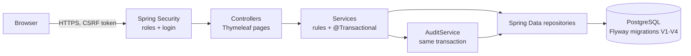

# checkUp

[](https://github.com/Maroon015/checkup-web/actions/workflows/ci.yml)

**A clinic booking and patient-records web app.** Patients find a clinic, book an open time
with a doctor and manage their medical record. Doctors run their schedule and see only their
own patients, and every look at a record is logged where the patient can see it.

Built with Java 25, Spring Boot 4, PostgreSQL and Thymeleaf.

**Live demo: https://checkup-web-fob5.onrender.com**
Click **"Log in as demo patient"** or **"Log in as demo doctor"** on the login page. All data
in the demo is made up. It runs on Render's free tier, so the first visit after a quiet spell
can take up to a minute while the server wakes up.

<!-- TODO: screenshots / GIF of booking a slot, the doctor dashboard, and "Who has seen my record" -->

---

## Features

**Patients**
- Sign up and log in (BCrypt-hashed passwords).
- Find clinics by city and book from a doctor's real open times (day picker, free slots only).
- Cancel online up to 24 hours ahead.
- Edit their medical record and phone numbers, and read their doctors' notes.
- **"Who has seen my record"**: every time a doctor opens or changes their record.

**Doctors**
- Weekly working hours that turn into bookable slots.
- Confirm, complete or cancel appointments.
- "My patients": only patients booked with them, plus each patient's record and clinical notes.

**Admins**
- System-wide audit log and job applications from the public careers page.

## Engineering highlights

These are the parts worth asking about in an interview.

**No double-booking, even under a race condition.** Two patients clicking the same slot at
the same moment both pass a "is it free?" check in Java. The database stops the second one
with `UNIQUE(doctor_id, booked_start)`. `booked_start` is set to `NULL` when an appointment is
cancelled, so cancelled bookings never block a slot. That gives the effect of a partial index
in a way that works on both PostgreSQL and H2. A test fires two real threads at the same slot,
five times over, and checks exactly one wins
([`ConcurrentBookingTest`](src/test/java/com/checkup/appointment/ConcurrentBookingTest.java)).

**An audit log that can't be quietly rewritten.**
- [`AuditLogRepository`](src/main/java/com/checkup/audit/AuditLogRepository.java) only has save
  and find methods; delete and update were never created. The entity is `@Immutable`.
- [`AuditService`](src/main/java/com/checkup/audit/AuditService.java) uses
  `Propagation.MANDATORY`, so a log entry is always saved in the same transaction as the change
  it describes.
- The log records *which* fields changed, never the medical values, so it doesn't become a
  second copy of private data.

**Access control on every record.**
- Pages find "your" record from your login, never from an id in the URL.
- Asking for someone else's appointment or record returns **404, not 403**, so ids can't be
  probed.
- Doctors can only open patients who have a non-cancelled appointment with them.
- CSRF protection is on for every form; all state changes are POSTs.

**Rules live in the domain model.** Appointment status only changes through `confirm()`,
`complete()`, `cancelByPatient()` (24-hour notice) and `cancelByDoctor()`. There is no setter
that could skip a rule. Time comes from an injected `Clock`, so tests freeze it.

## Architecture



Code is organized **by feature**: `account`, `appointment`, `audit`, `careers`, `clinic`,
`doctor`, `patient`. Each package holds its entity, repository, service, controller and pages.

| Layer | Tools |
|---|---|
| Web | Spring Boot 4 (Web MVC), Thymeleaf, plain CSS |
| Security | Spring Security 7: form login, BCrypt, roles, CSRF |
| Data | Spring Data JPA (Hibernate 7), Flyway, PostgreSQL in production, H2 for development and tests |
| Tests | JUnit 5, AssertJ, MockMvc, Spring Security Test: 93 tests |
| Delivery | GitHub Actions (tests, a PostgreSQL smoke test, Docker build), Docker, Docker Compose |

## Running it

**With Docker** (the app and PostgreSQL together):

```bash
docker compose up --build
```

**Without Docker** (in-memory H2 database, resets on restart):

```bash
./mvnw spring-boot:run          # Windows: .\mvnw.cmd spring-boot:run
```

Then open http://localhost:8080. Demo logins (password `demo-password`):

| Role | Email |
|---|---|
| Patient | `alex.morgan@example.com` |
| Doctor | `jordan.patel@example.com` |
| Admin | `admin@example.com` |

**Tests:** `./mvnw test`

## Privacy

All data in this project is fictional (`example.com` emails, `555` phone numbers). The design
follows the spirit of Ontario's health-privacy law (PHIPA): need-to-know access, a patient-visible
access log, and no medical values in logs. It is a portfolio project, **not** a certified medical
records system.

## History

checkUp started as a Grade 12 group project by **Tarun, Ben and Hamza** (January 2025): a
console app with `Scanner` menus that stored everything in `.txt` files. This version is a
ground-up rebuild as a web app. What changed and why:

| Original console app | This version |
|---|---|
| Data in `.txt` files, re-read line by line | PostgreSQL with migrations, foreign keys and constraints |
| Each booking overwrote `Appointments.txt`, so only one could exist | Any number of appointments, with real times, doctors and statuses |
| Plain-text passwords; card numbers stored in a file | BCrypt hashes; no payment data collected at all |
| Patients found by full name (two "Alex Morgan"s clash) | Ids, plus a unique email per account |
| Any doctor could print any patient's record | Need-to-know access, and every view is logged |
| Invalid input silently replaced (bad blood type became "A+") | Validation with clear messages; invalid values rejected |
| Job applications "protected" by a random number on screen | Admin-only page behind role-based security |

Thanks to Ben and Hamza for the original idea and the first version.

## Roadmap

- Email reminders before appointments
- A documented REST API (OpenAPI), opening the door to a mobile app
- Pagination and search on long lists
- Rate limiting / CAPTCHA on the public careers form
